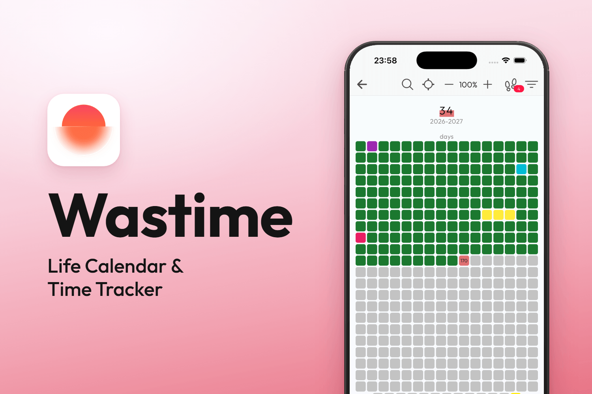
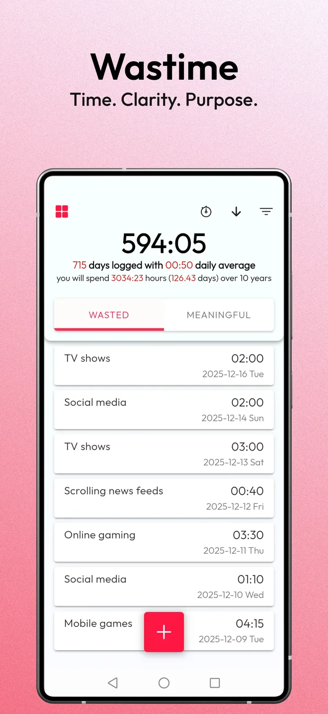
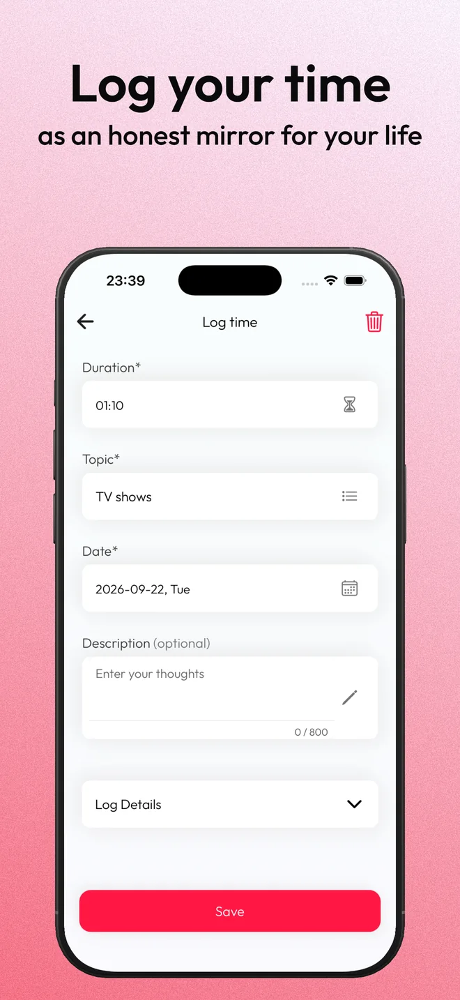
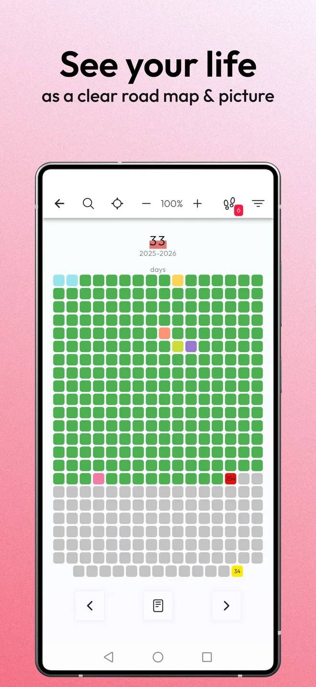
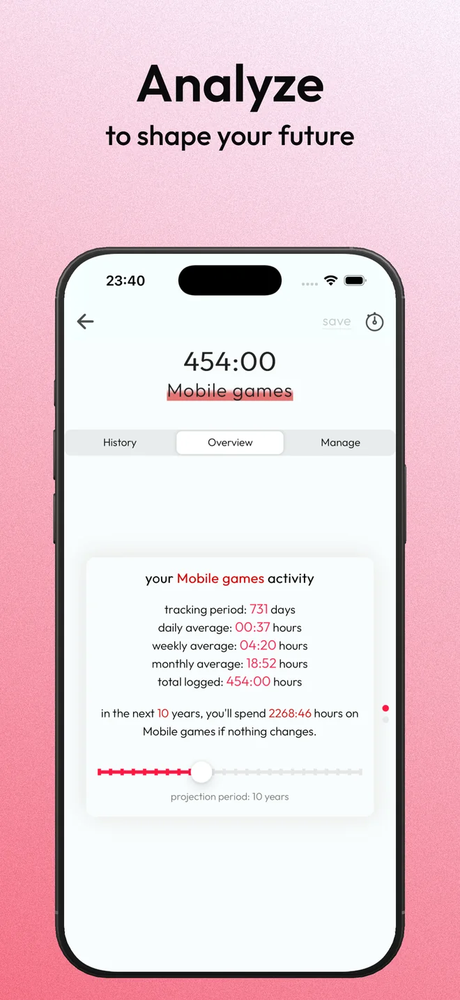
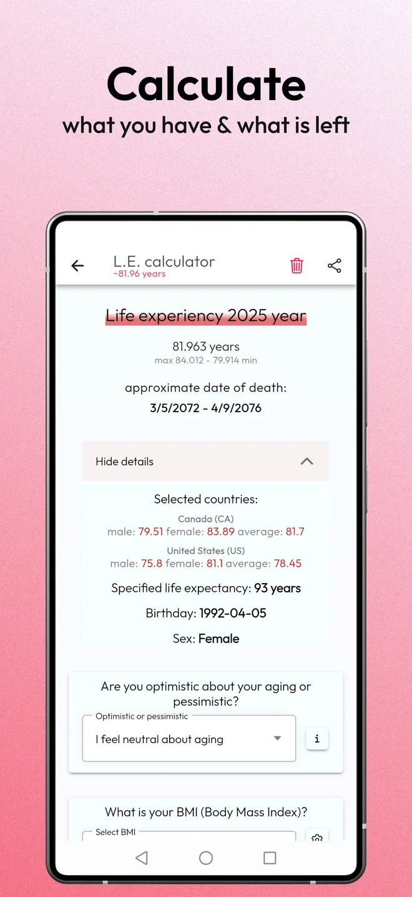
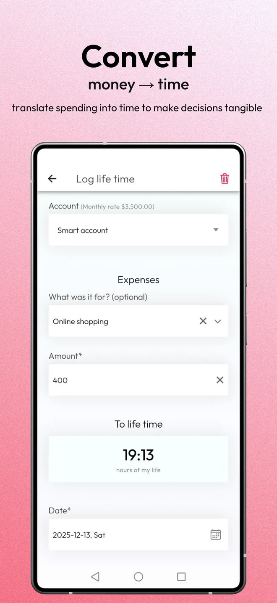
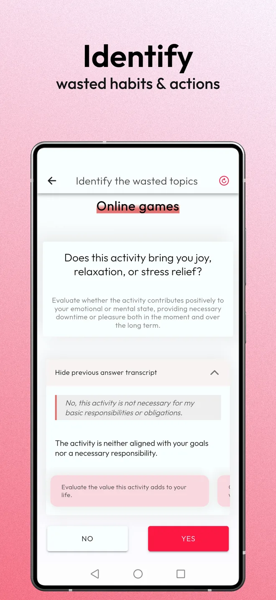
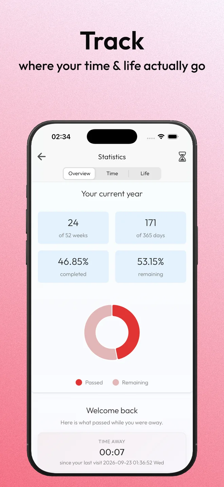

<div align="center">



**Mindful Time, Life &amp; Event Tracker** — *See your time. Live on purpose.*

`Free core` · `Offline-first` · `Privacy by default`

[](https://wastime.app/)
[](#platforms--links)
[](LICENSE)


</div>

---

## What is Wastime?

**Wastime** helps you see the real value of your time and live on purpose. It combines
mindful time tracking, life calendars, practical calculators, and gentle motivation — so
small daily wins turn into meaningful change.

> "An average life is ~4,680 weeks. One of them is this week." — *make it count.*

Unlike attention-hungry productivity apps, Wastime is designed to be **used briefly and
closed**: no endless feeds, no pushy notifications, no gamification. You reflect on your
time, make a decision, and get back to life outside the screen.

> **About this repository** — this is the **public overview** of the Wastime project. It
> describes the product, its architecture, and the technology behind it.

---

## Philosophy

| Principle | What it means |
| --- | --- |
| **Privacy & offline first** | Your data stays on your device. The app works fully offline by default. Sync is optional and transparent — you always know what's being sent. |
| **Respect for your time** | No infinite scroll, no dark patterns. Get an insight quickly and return to your life. |
| **A tool, not a life center** | Wastime is a companion, not another universe to live inside. |
| **Your control over data** | Choose what to track, which modules to use, which notifications to receive. Delete anything, anytime. |
| **Core is free** | Full essential functionality from day one — no paywalls for the basics. |

---

## Core features

- **⏳ Time Tracking (Meaningful vs Wasted)** — two spaces for investments and time-sinks,
  topics &amp; groups, quotas and deadlines with progress and forecasts, a consistency metric,
  powerful filters, and JSON import/export.
- **⏱️ Timers** — one active timer across the app, one-tap start/stop, pause history, and
  conversion into a time entry that feeds your stats.
- **📅 Life Calendars** — *Life in Weeks* (your whole life as weeks: lived vs remaining) and
  *Life in Days* (a year view with the current day highlighted), with colored milestones,
  priorities, groups, filters, and search.
- **🧮 Calculators (5 types)** — *Live* (time left with loved ones), *Wasted* (an honest
  total, without self-blame), *Basic*, *24H* (your day at a glance), and *Reverse* (from a
  goal to the daily time it needs).
- **💸 Money → Time Converter** — turn any purchase into "hours of life", full days, or
  working days; account settings for income, tax, and currency; see your top "life-cost"
  categories.
- **📊 Stats &amp; Insights** — overviews and trend slides that grow with your data, filters by
  topic / period / minimum duration. Offline-first, sync-ready.

---

## Screenshots

<div align="center">

<table>
  <tr>
    <td></td>
    <td></td>
    <td></td>
    <td></td>
  </tr>
  <tr>
    <td></td>
    <td></td>
    <td></td>
    <td></td>
  </tr>
</table>

</div>

---

## Platforms &amp; links

| | |
| --- | --- |
| 🌐 **Website** | <https://wastime.app/> |
| 🍏 **App Store (iOS)** | <!-- TODO: add App Store link --> *coming — see website* |
| 🤖 **Google Play (Android)** | <!-- TODO: add Google Play link --> *coming — see website* |
| 💻 **Web app** | available via the website |

Mobile apps are the primary experience, with web access available.

---

## Architecture at a glance

Wastime is built as three cooperating applications sharing one API contract (OpenAPI):

```text
┌─────────────────────┐        ┌─────────────────────┐
│   Mobile app        │        │  Web                │
│  Ionic + Angular    │        │  Angular 21 (SSR)   │
│  + Capacitor        │        │  landing + blog     │
│  (iOS / Android)    │        │                     │
└──────────┬──────────┘        └──────────┬──────────┘
           │  HTTPS (OpenAPI client)      │
           │                              │
           ▼                              ▼
        ┌──────────────────────────────────────┐
        │   Backend API — ASP.NET Core 9.0     │
        │   layered: Api · Core · Data · …     │
        └──────────────────┬───────────────────┘
                           │
        ┌──────────────────┴───────────────────┐
        │  Azure: PostgreSQL · Blob Storage ·  │
        │  Key Vault · Application Insights     │
        │  Firebase: Auth · Analytics · …      │
        └───────────────────────────────────────┘
```

Detailed design docs:

| Document | Contents |
| --- | --- |
| 📱 [Mobile app architecture](docs/architecture-mobile.md) | Ionic/Angular layers, offline-first storage &amp; sync, native Capacitor plugins |
| 🔧 [Backend architecture](docs/architecture-backend.md) | .NET layered design, PostgreSQL, Azure infrastructure, security, CI/CD |
| 🌐 [Web site architecture](docs/architecture-web.md) | Angular SSR / prerendering, markdown blog pipeline, SEO, deployment |
| 🧱 [Technology stack](docs/tech-stack.md) | Full stack with versions and rationale |

---

## Technology stack (short)

| Area | Technologies |
| --- | --- |
| **Mobile** | Ionic 8, Angular 21, Capacitor 8, TypeScript, SQLite (offline), ECharts |
| **Backend** | ASP.NET Core 9.0 (C#), Entity Framework Core, PostgreSQL |
| **Web** | Angular 21 + SSR, Bootstrap 5, markdown-driven blog |
| **Cloud** | Microsoft Azure (App Service, PostgreSQL Flexible Server, Blob Storage, Key Vault, Application Insights) |
| **Platform services** | Firebase (Auth, Analytics, Crashlytics, Performance, Remote Config), RevenueCat (subscriptions) |
| **Delivery** | GitHub Actions CI/CD, Docker, Firebase Hosting / Azure Static Web Apps |

See [docs/tech-stack.md](docs/tech-stack.md) for the full breakdown with versions.

---

## Status

Wastime is an actively developed product. This repository is documentation-only and is kept
in sync with the live application.

<!-- TODO: add contact / social links -->

---

## License

The documentation content in this repository is licensed under
**[Creative Commons Attribution-NonCommercial-NoDerivatives 4.0 International (CC BY-NC-ND 4.0)](LICENSE)**.
You may read and share it with attribution, but not use it commercially or distribute
modified versions.

The **Wastime** name, logos, screenshots, and the application source code are **not** covered
by this license and remain the property of their respective owners. See [LICENSE](LICENSE) for
details.
